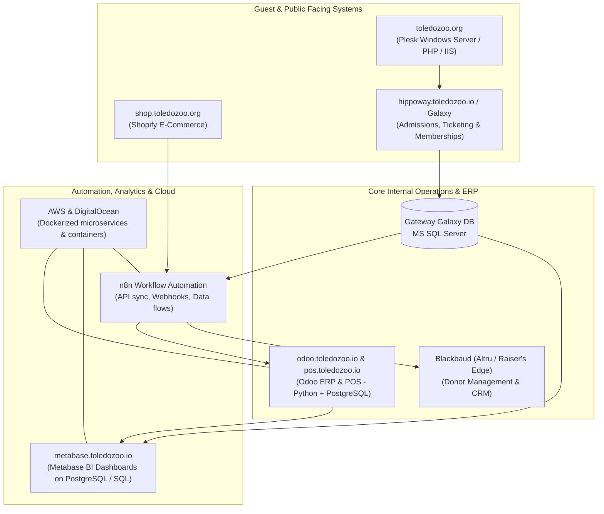

# The Toledo Zoo & Aquarium - Senior Development Operations Engineer
## Interview Preparation Master Playbook & Insider Intelligence

> [!IMPORTANT]
> **Interview Logistics Overview**
> - **Role:** Senior Development Operations Engineer
> - **Reporting To:** Trevor Reiter, Vice President of Information Technology
> - **Interview Panel:**
>   1. **Trevor Reiter** - Vice President of Information Technology (Hiring Manager)
>   2. **Max Weaver** - Technical Support Specialist (Peer / Technical Operations)
>   3. **Carol Espen** - Senior Vice President Human Resources (Culture / Executive Leadership)
> - **Format:** Microsoft Teams Video Call

---

## 1. Verified Toledo Zoo Tech Stack & Infrastructure Intelligence

Through live infrastructure analysis and public disclosures, here is the exact map of technology running at The Toledo Zoo & Aquarium:

### The Live Tech Stack Breakdown:
1. **Odoo ERP & Point of Sale (`odoo.toledozoo.io` & `pos.toledozoo.io`):**
   - Verified running on Cloudflare.
   - Odoo is natively written in **Python** and uses **PostgreSQL** as its underlying database engine.
   - Used for internal departmental operations, inventory tracking, and POS synchronization across retail and concessions.
2. **Business Intelligence & Reporting (`metabase.toledozoo.io`):**
   - Verified live internal Metabase instance running on Cloudflare.
   - Connects directly to their relational databases (PostgreSQL, MS SQL Server, MySQL) to give department directors operational reports on guest attendance, revenue, inventory, and departmental KPIs.
3. **Ticketing, Admissions & POS (Gateway Ticketing Systems / Galaxy):**
   - The zoo uses **Gateway Ticketing Systems (Galaxy)** for admissions, ticketing, and turnstiles.
   - Galaxy relies on **Microsoft SQL Server (`MS SQL Server`)** as its database engine. This is why MS SQL Server is specifically highlighted in the job description!
4. **Online Retail & Merchandising (`shop.toledozoo.org`):**
   - Verified running on **Shopify** with Cloudflare edge routing.
   - Products, orders, and sales data must be reconciled into Odoo and financial systems.
5. **Main Website (`toledozoo.org`):**
   - Verified running on Windows Server with **Plesk (`PleskWin`)**, serving web assets and PHP backend routines.
6. **Integration & Automation Layer (`n8n`):**
   - The zoo uses **n8n** (node-based workflow automation) to connect the dots: synchronizing Shopify orders, Gateway Ticketing events, and web registrations into Odoo and Blackbaud without manual re-keying.
7. **Cloud & Infrastructure:**
   - Linux / Docker container environments hosted on **AWS** and **DigitalOcean**.
   - Cloud unified communications (TrustUC / Telesystem) for campus-wide staff mobility.

---

## 2. Interview Panel Dossier & Insider Connections

### Max Weaver - Technical Support Specialist
- **Background & Insider Note:** Max Weaver is an alumnus of **Bowling Green State University (BGSU)**, where he was involved in BGSU Athletics (supporting ice hockey equipment management) and club sports.
- **The Rapport Hook:** **You are both BGSU Falcons!** You can naturally reference BGSU when introducing yourself. This immediately builds peer rapport and trust.
- **His Day-to-Day:** Field tech support across a massive 70+ acre campus. He supports desktops, printers, POS hardware, Wi-Fi connectivity, ticket scanners, and user accounts.
- **What He Cares About:**
  - Clear runbooks for when things go wrong on weekends.
  - An engineer who doesn't look down on support or brush off user tickets.
  - Automating repetitive support tasks (e.g. account provisioning, password resets, sync failures).

### Trevor Reiter - Vice President of Information Technology
- **Background & Insider Note:** He is the long-tenured leader of IT at the Zoo. He led a major network and communications infrastructure overhaul in partnership with Telesystem (implementing TrustUC cloud communications), modernizing legacy phone and network systems without interrupting daily operations or animal habitats.
- **His Day-to-Day:** Balancing campus-wide physical infrastructure, vendor relationships (Gateway, Telesystem, Blackbaud), cybersecurity, budget, and modern software adoption.
- **What He Cares About:**
  - **Zero Downtime:** 24/7 reliability for animal care systems, guest admissions, and retail revenue.
  - **Pragmatic Architecture:** Connecting systems reliably (Odoo + Galaxy + Shopify + Metabase) without creating unmanageable tech debt.
  - **Independent Problem-Solver:** An engineer who can take an ambiguous operational bottleneck and deliver a tested, documented solution.

### Carol Espen - Senior Vice President Human Resources
- **Background & Insider Note:** Holds an MBA, CLRP (Certified Leave and Disability Management Professional), and a **Lean Six Sigma Green Belt** certification.
- **The Lean / Process Hook:** Her Six Sigma Green Belt means she cares deeply about **eliminating waste, reducing manual friction, process standardization, and measurable efficiency**.
- **Her Day-to-Day:** Overall staff satisfaction, departmental collaboration, culture, safety, and HR operational workflows.
- **What She Cares About:**
  - Cross-department communication: Can you speak with animal keepers, curators, and guest service staff without technical jargon?
  - Process improvement: How technology simplifies daily tasks rather than creating confusion.
  - Local pride and commitment to the Toledo community.

---

## 3. The 90-Second "Tell Me About Yourself" Pitch

When asked *"Tell us about yourself and what brought you to the Toledo Zoo"*, use this customized script:

> "I am a software and systems engineer with a bachelor's and master's in Computer Science from Bowling Green State University, where I finished with a 4.0 GPA. Over the past several years, I have worked across full-stack development, cloud infrastructure, and data automation, focusing on building tools and pipelines that help internal teams run smoothly.
>
> Most recently at Actual Reality Technologies in Perrysburg, I have been engineering an AI Gateway with automated routing, Langfuse tracing, Slack alerts, and CI/CD deploy gates, while also building internal customer portal workflows with health checks and cache reliability. Before that, at SmartSolve in Bowling Green, I architected a Next.js and PostgreSQL onboarding tracker with SSO to centralize HR workflows, and built Docker devcontainers for reproducible developer environments. I also have deep data and cloud experience from AAIS, where I automated production SQL and AWS Glue pipelines processing over 20 terabytes of data across MySQL, Oracle, and PostgreSQL.
>
> What really stood out to me about the Toledo Zoo is the opportunity to bridge software development and IT operations in an organization where technology directly empowers both the internal teams across the grounds and the guest experience. Having spent my academic and early professional career right here in Northwest Ohio, getting to contribute my skills to the Zoo's mission is an incredible fit, and I am excited to discuss how I can help streamline your software and infrastructure."

---

## 4. Addressing the "Senior" Title & Early-Career Trajectory

### Verbal Framework:
> "To me, seniority in development operations isn't measured by tenure sitting behind a desk; it's about architectural maturity, accountability, and the ability to own a system from discovery to deployment.
>
> Across my projects at Actual Reality, SmartSolve, and AAIS, I have consistently taken ambiguous operational problems, mapped out the data relationships, designed the architecture, built the automated CI/CD and monitoring guardrails, and written clear runbooks so anyone on the team can support it. I bring strong computer science fundamentals from my Master's, a track record of building reliable production systems, and the energy to jump in, master your Odoo and n8n workflows, and deliver immediate value."

---

## 5. Connecting Your Experience to the Toledo Zoo Tech Stack

| Toledo Zoo System | Your Verified Experience | Talking Point / Verbal Bridge |
| :--- | :--- | :--- |
| **Odoo ERP (`odoo.toledozoo.io`)** | Python + PostgreSQL (SmartSolve, AAIS, Career Ops) | *"Odoo is built on Python and PostgreSQL, which are two of my strongest daily technologies. Because I understand relational data modeling, ORMs, and Python API architecture, I can dive right into Odoo modules, customize workflows, and write reliable backend scripts to sync operational data."* |
| **Metabase (`metabase.toledozoo.io`)** | SQL profiling, data modeling, AAIS CFO reporting | *"I have worked extensively with data modeling and analytics pipelines. At AAIS, I profiled 160+ tables into 25 clean business domains. I know how to structure clean SQL views and aggregations so Metabase dashboards load quickly and provide clear operational insights for non-technical managers."* |
| **n8n & Workflow Automation** | Python automation, Webhooks, Event-driven Lambda, Slack alerts | *"Whether using node-based platforms like n8n or writing Python event handlers, the core architecture is the same: listening for webhook events, validating schemas, handling rate limits, error logging, and sending failure alerts. I love workflow automation because it removes manual re-keying between systems."* |
| **Gateway Galaxy & MS SQL Server** | SQL database profiling, indexing, schema migration | *"Galaxy ticketing runs on Microsoft SQL Server. While much of my recent work has been in PostgreSQL and MySQL, relational database principles - ACID compliance, indexes, execution plans, connection pools, and query optimization - translate directly to MS SQL Server."* |
| **Shopify E-Commerce (`shop.toledozoo.org`)** | REST APIs, JSON data pipelines, Webhooks | *"With Shopify handling online retail, connecting order webhooks to internal inventory in Odoo or accounting requires clean payload validation and idempotent processing. I have built similar API pipelines normalizing JSON data into internal tables."* |
| **AWS & Cloud Infrastructure** | AWS Glue, S3, Lambda, IAM, Docker devcontainers | *"I build cloud infrastructure with a focus on least-privilege IAM roles, containerized reproducibility using Docker, and automated deployment checks so environments stay consistent between testing and production."* |

---

## 6. High-Probability Interview Questions & Recommended Answers

### Q1: "How do you approach automating a manual process that an internal department has been doing by hand for years?"
*(Targeted to Carol's Lean Six Sigma mindset and Trevor's uptime requirements)*
> "I approach process automation with three principles:
> 1. **Understand the human workflow first:** I sit down with the users (whether in retail, admissions, or HR) to map out their exact steps, edge cases, and exceptions. You cannot automate a process until you respect why it exists.
> 2. **Build with validation and error-handling:** I define clear data contracts and automate incrementally. We run the automated pipeline (in Python or n8n) in parallel with the manual process to verify that results match 100%.
> 3. **Visibility and runbooks:** Automations must never fail silently. I build automated notifications (like Slack alerts or email summaries) and create a clear runbook so frontline support knows exactly how to verify or re-trigger the workflow."

### Q2: "A ticketing or POS integration goes down on a busy Saturday. How do you triage and resolve it?"
*(Targeted to Trevor and Max)*
> "First, coordinate communication: notify Trevor and support immediately so frontline staff have clear messaging and backup procedures (like offline ticket scanning).
>
> Second, check telemetry: look at health checks, Cloudflare status, web server logs, and database connection pool metrics. Did a deployment happen recently? Is an API endpoint timing out, or is the MS SQL Server or PostgreSQL database under high lock contention?
>
> Third, restore operations first before root-cause deep dive: if a service crashed, restart the container or scale instances; if a bad deploy was pushed, roll back immediately.
>
> Once stability is restored, write an automated test fixture, add health-check monitoring, and document the incident in a runbook so it cannot happen again."

### Q3: "How do you explain technical issues to non-technical zoo staff?"
*(Targeted to Carol and Max)*
> "I translate technical concepts into operational realities without jargon. Instead of saying, *'The PostgreSQL connection pool timed out because of an unindexed join,'* I explain, *'The reporting tool was trying to pull too much history at once and slowed down the system. We adjusted how it searches, and it is running normally now.'*
>
> Most importantly, I focus on their workflow: *'What were you trying to do, is it working for you now, and what can we do to make this easier next time?'*"

---

## 7. Strategic Questions to Ask the Panel

### For Trevor Reiter (VP of IT):
1. *"Trevor, between your on-premise infrastructure, Windows web servers, and cloud instances for Odoo and Metabase, what is your primary infrastructure priority over the next year -- cloud consolidation, or hardening campus-wide reliability?"*
2. *"How are you currently handling integrations between Gateway Galaxy ticketing, Shopify, and your Odoo ERP -- is that primarily orchestrated through n8n today, and where are the biggest integration friction points?"*

### For Max Weaver (Technical Support Specialist):
3. *"Max, from a frontline IT support perspective, what is the most repetitive manual request or sync error you see staff submitting that you wish had an automated, self-service solution?"*
4. *"When an issue gets escalated from frontline support to development and operations, what does a great handoff look like to you?"*
*(Feel free to mention your shared BGSU connection here!)*

### For Carol Espen (SVP of HR):
5. *"Carol, with your background in Lean Six Sigma and operational efficiency, which departments across the Zoo have the greatest opportunity for workflow streamlining and automation right now?"*
6. *"How does the IT and DevOps team collaborate with other departments to support the Zoo's broader community and conservation mission?"*

---

## 8. Final Checklist & Mental Framing

- [ ] **BGSU Connection:** Natural common ground with Max Weaver.
- [ ] **Lean Six Sigma Alignment:** Process efficiency and waste reduction for Carol Espen.
- [ ] **Infrastructure Reliability:** Focus on uptime, monitoring, and practical architecture for Trevor Reiter.
- [ ] **Confidence:** You are local, you have a 4.0 GPA Master's from BGSU, and you have built real, production-tested pipelines and tools. Speak with warmth, clarity, and enthusiasm!

---

## 9. Rapid Tech Crash Course & Alignment Guide

### 1. Odoo ERP (Running at odoo.toledozoo.io & pos.toledozoo.io)
- **What it is:** An open-source, all-in-one ERP (Enterprise Resource Planning) platform. It provides modular apps for Inventory, Point of Sale (POS), Accounting, Purchasing, HR, and Maintenance.
- **Under the Hood:** Built entirely in **Python** using **PostgreSQL** as its database engine. Custom logic is written in Python modules that map to Postgres tables via Odoo's ORM. Exposes REST and JSON-RPC APIs.
- **Why Toledo Zoo uses it:** Manages retail inventory across zoo gift shops, food and beverage concessions, purchasing, and internal maintenance without the millions in licensing costs of SAP or Oracle.
- **Your Alignment Script:**
  *"I know Odoo is an open-source ERP built natively on Python and PostgreSQL. Since Python and PostgreSQL are two of my daily core technologies from SmartSolve and AAIS, the architectural mental model is second nature: relational data modeling, ORMs, and building REST or JSON-RPC API integrations. Working with Odoo modules and backend data synchronization is a very natural extension of my skill set."*

### 2. n8n (Workflow Automation)
- **What it is:** An open-source, node-based workflow automation and integration platform (like Zapier, but self-hosted in Docker, developer-friendly, and secure).
- **Under the Hood:** Built on Node.js and TypeScript. Workflows are directed graphs triggered by webhooks or cron schedules, transforming JSON payloads between different service APIs with built-in retry and credential handling.
- **Why Toledo Zoo uses it:** Acts as the "connective tissue" across their systems -- e.g., capturing a Shopify gift shop order, decrementing stock in Odoo, updating financial records, and sending a notification.
- **Your Alignment Script:**
  *"I understand n8n as the workflow orchestration fabric. Even when I have automated workflows purely through code in Python, AWS Lambda, or webhooks, the underlying architectural patterns are identical: listening to webhook triggers, validating and transforming JSON payloads, managing rate limits and credentials, and configuring error retries and alerting. I appreciate n8n because it provides visual transparency for the whole team while allowing custom code when needed."*

### 3. Blackbaud Platforms (Altru / Raiser's Edge)
- **What it is:** The premier cloud CRM and donor management platform designed specifically for non-profits, museums, and zoos.
- **Under the Hood:** Cloud-hosted system exposing the modern RESTful **Blackbaud SKY API** (OAuth 2.0). Stores donor histories, gift campaigns, animal adoptions, and membership renewals.
- **Why Toledo Zoo uses it:** Manages philanthropic donors, foundation grants, zoo memberships, and capital campaigns.
- **Your Alignment Script:**
  *"I recognize Blackbaud as the gold standard in non-profit and zoological fundraising and membership management. From a systems perspective, my focus with Blackbaud is seamless data integrity: utilizing the Blackbaud SKY API with OAuth authentication to keep membership records and donor data synchronized between online portals, ticketing gates, and internal reporting, without staff having to do manual re-entry."*

### 4. Metabase (Running at metabase.toledozoo.io)
- **What it is:** An open-source Business Intelligence (BI) and analytics tool that connects directly to SQL databases to generate dashboards, charts, and automated reports.
- **Under the Hood:** Connects to PostgreSQL, MS SQL Server, and MySQL. Executes optimized SQL queries and provides a visual query builder for non-technical users.
- **Why Toledo Zoo uses it:** Provides executive and departmental dashboards on daily gate attendance, exhibit popularity, concession sales, and budget tracking.
- **Your Alignment Script:**
  *"I view Metabase as the vital bridge between raw database tables and operational decision-makers. At AAIS, I profiled 160+ database tables and organized them into clean business domains for CFO and management reporting. I know how to structure clean SQL views, indexes, and aggregations so Metabase dashboards load instantaneously without locking production transaction tables."*

### 5. Microsoft SQL Server (MS SQL Server)
- **What it is:** Microsoft's enterprise relational database management system (RDBMS) running T-SQL.
- **Why Toledo Zoo uses it:** Powers Gateway Ticketing Systems (Galaxy), which handles park admissions, turnstiles, and box-office POS.
- **Your Alignment Script:**
  *"While my recent projects have centered on PostgreSQL and MySQL, core RDBMS principles are universal: ACID compliance, relational schemas, indexing strategies, query execution plans, connection pooling, and transactional integrity. Navigating MS SQL Server and querying it via Python or integration tools is very straightforward for me."*

### 6. DigitalOcean vs. AWS
- **What it is:** A lightweight cloud hosting provider known for Droplets (virtual machines) and managed databases, offering a simpler, cost-effective alternative to AWS.
- **Why Toledo Zoo uses it:** Cost-effective hosting for Dockerized internal microservices (like n8n, Odoo, or Metabase).
- **Your Alignment Script:**
  *"I have deep hands-on experience with AWS (Glue, S3, Lambda, IAM). DigitalOcean operates on the exact same Linux and containerized principles, but with lower operational complexity. Whether managing containers on AWS EC2 or DigitalOcean Droplets, maintaining Docker lifecycles, environment variables, and reverse proxies like Cloudflare is identical."*

### 7. Redis
- **What it is:** An in-memory, key-value data structure store used as a high-speed cache, session store, or message broker.
- **Why Toledo Zoo uses it:** Prevents database lockups during ticket rushes by caching fast-changing data (like ticket counts or session logins).
- **Your Alignment Script:**
  *"I understand Redis as the high-throughput in-memory caching and session layer. In web applications and API pipelines, I look at Redis to reduce latency on repeated reads, manage session state, and prevent database bottlenecks during traffic surges by setting proper TTLs and cache-invalidation strategies."*

### 8. PHP
- **What it is:** A server-side web scripting language powering traditional websites, CMSs, and Plesk-hosted web apps.
- **Why Toledo Zoo uses it:** Powers server-side routines on their main website toledozoo.org hosted on Windows Plesk.
- **Your Alignment Script:**
  *"My primary development languages are Python, JavaScript, and Java, but having a strong grounding in object-oriented programming, MVC architectures, HTTP request lifecycles, and backend web APIs makes reading and maintaining PHP scripts very natural. The logic of routing, database queries, and data validation translates directly."*

---

## 10. Panel Psychology, HR Deep-Dive & Toledo Zoo Interview Dynamics

### A. Deep Dossier on the Three Interviewers

#### 1. Trevor Reiter (Vice President of Information Technology)
- **Status & Standing:** Executive Officer listed on IRS Form 990 key management personnel filings. He is not just an IT manager; he is part of the Zoo's executive leadership reporting directly to the C-suite.
- **His Mental Model:**
  - *Risk Management & Uptime:* Technology failure at the zoo means guests stuck at turnstiles, ticket kiosks going dark, POS lines backing up, or life-support environmental telemetry dropping offline.
  - *Autonomous Problem Solver:* As VP, Trevor does not have time to micromanage code commits. He wants an engineer who can be given a high-level operational goal ("connect Shopify sales to Odoo inventory and send an alert if reconciliation drifts") and deliver it start to finish.
  - *Pragmatic Architecture:* He chose Odoo, Metabase, and n8n because they are flexible and cost-effective compared to enterprise vendor bloat. He respects engineers who build maintainable solutions over complex, fragile architectures.

#### 2. Max Weaver (Technical Support Specialist)
- **Status & Standing:** Frontline boots-on-the-ground support specialist. An alumnus of Bowling Green State University (BGSU) who worked in athletics equipment management.
- **His Mental Model:**
  - *The Weekend & Event Reality:* When a system breaks during "Lights Before Christmas" or a Saturday afternoon, Max is the one taking frantic radio calls from admissions and retail staff.
  - *Runbook Dependence:* He needs clean documentation, clear error codes, and self-service runbooks so frontline staff can resolve minor hiccups without waiting on engineering.
  - *Peer Respect:* He will evaluate whether you are someone who collaborates with IT support with empathy and patience, or someone who hides behind a monitor and dismisses support tickets.

#### 3. Carol Espen (Senior Vice President of Human Resources)
- **Status & Standing:** Executive Officer, MBA, Certified Labor Relations Professional (CLRP), and Lean Six Sigma Green Belt. Recently authored executive statements regarding strategic realignment of zoo staffing and operational resources.
- **Her Mental Model:**
  - *Lean Six Sigma Mindset:* She thinks in terms of eliminating process waste, standardizing workflows, reducing manual friction, and measurable return on investment for staff time.
  - *Cross-Departmental Harmony:* The Toledo Zoo employs animal keepers, veterinary staff, horticulture teams, food service cashiers, educators, and seasonal workers. She will test whether you can communicate with non-technical people with warmth and respect.
  - *Institutional Loyalty:* She wants to know that you see the Toledo Zoo as an inspiring, meaningful career destination in Northwest Ohio, not just a stepping stone.

---

### B. What Carol (HR) Will Likely Ask & How to Answer

#### Question 1: "Can you tell me about a time you identified an inefficient process and improved or automated it?"
- **Why She Asks:** Her Lean Six Sigma background. She wants to see if you instinctively spot wasted time and eliminate manual steps.
- **Your Model Answer:**
  *"At AAIS, our finance and data teams were spending hours every week manually running individual SQL scripts in DBeaver across 160 tables to generate billing reports for 700 member companies. It was repetitive, took up valuable analyst hours, and had room for human entry error.
  I mapped out the entire data flow, identified where the manual bottlenecks were, and automated the pipeline using Python, PySpark, and AWS Glue. We reduced the manual burden down to zero, delivered 24-hour data latency, and gave users a self-service validated report. To me, the greatest value of engineering is giving hours back to people so they can focus on higher-value work."*

#### Question 2: "How do you communicate with staff members who are non-technical or frustrated by a tech glitch?"
- **Why She Asks:** Evaluating patience, empathy, and translation ability across keepers and admissions staff.
- **Your Model Answer:**
  *"I always start by acknowledging their frustration and validating their experience. Technology exists to serve their work, not to create barriers.
  I remove all technical jargon. Instead of talking about database timeouts or API endpoints, I explain what happened in plain terms: 'The system had trouble connecting to the ticketing records, so we are resetting that connection right now.'
  Most importantly, I give realistic expectations, confirm once the fix is working in their actual hands, and ask if there's anything we can do to make their routine smoother moving forward."*

#### Question 3: "Why The Toledo Zoo & Aquarium? Why a non-profit rather than a traditional tech company?"
- **Why She Asks:** Checking genuine mission alignment and community connection.
- **Your Model Answer:**
  *"Having grown up and earned both my Bachelor's and Master's degrees right here at BGSU, the Toledo Zoo has always been an iconic pillar of our region.
  In large commercial tech companies, software engineers are often isolated cogs optimizing an ad metric. At the Toledo Zoo, the technology I build directly impacts the experience of families visiting the aquarium, helps frontline staff do their jobs without administrative headaches, and supports conservation and education. Having direct, visible impact in a community I care about is exactly where I want to build my career."*

#### Question 4: "This position is exempt and may occasionally require working outside standard hours for emergencies, system upgrades, or major events. How do you handle that?"
- **Why She Asks:** The Zoo runs major seasonal events (like Lights Before Christmas) and 24/7 animal habitat operations.
- **Your Model Answer:**
  *"I completely understand and expect that in a development operations role. In 24/7 environments like the Zoo, systems don't stop at 5:00 PM.
  My philosophy is twofold: first, build proactively with automated tests, health-check alerting, and graceful fallbacks so off-hours emergencies are minimized in the first place; and second, when an upgrade or major event requires off-hours support, I am fully committed to being on-hand and ensuring the team and our visitors have flawless uptime."*

---

### C. Triad Panel Dynamics: How to Win the Room

When answering any open question, use the **Triple-Target Technique**:
1. **The Technical Anchor (for Trevor):** Name the technical method, architecture, or tool cleanly (Python, PostgreSQL, CI/deploy gates, health checks).
2. **The Operational Support (for Max):** Mention how you document it, create runbooks, or set up alerts so support is never left in the dark.
3. **The People & Process Impact (for Carol):** Conclude with how it saved staff time, eliminated friction, or supported the broader mission.
